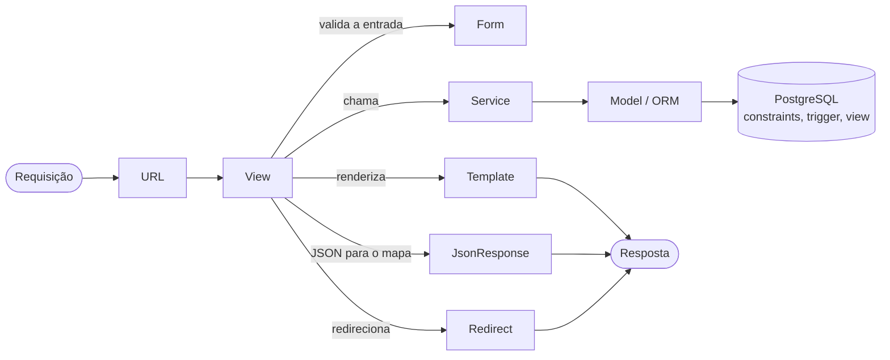

# Arquitetura

O projeto segue MVT, com as regras de negócio concentradas na camada de service. O motivo dessa decisão está na [ADR 0001](adr/0001-mvt-com-camada-de-service.md).

## Apps

| App | Responsabilidade |
|---|---|
| `core` | Configurações e URLs do projeto |
| `comum` | Código compartilhado: model base abstrato, mixins de acesso, cálculo de distância |
| `contas` | Usuário, cadastro, verificação do celular e autenticação |
| `trechos` | Bairros, obstáculos, trechos, histórico, mapa e gestão de trechos |
| `feedbacks` | Feedbacks, fotos de feedback, notificações e análise |

Dependências permitidas: `contas`, `trechos` e `feedbacks` podem importar de `comum`, e `feedbacks` pode importar de `trechos`. No sentido contrário há uma única exceção: o `TrechoConsultaService` lê os relatos de feedback para o detalhe do trecho, com o import feito dentro do método para evitar import circular.

## Fluxo de uma requisição



## Views (`<app>/views/`)

- Toda view é uma classe que herda diretamente de `django.views.View`.
- Implemente apenas os métodos HTTP necessários (`get`, `post`).
- Mixins de controle de acesso são permitidos: `LoginRequiredMixin` e `comum.mixins.AdministradorRequeridoMixin`.
- Não use views baseadas em função nem generic views (`ListView`, `CreateView` etc.).
- A view só recebe a requisição, chama o service e retorna a resposta (template, JSON ou redirect).
- A view não contém regra de negócio nem acessa o ORM diretamente. Por isso, não usa `get_object_or_404`.
- `login()` e `logout()` são chamados na view, pois alteram a sessão HTTP e precisam de `request`.
- As views de API do mapa retornam `JsonResponse` com dados já preparados pelo service.

## Forms (`<app>/forms/`)

- Validam o formato da entrada e renderizam os campos.
- A gravação é feita pelo service, sem `form.save()`.

## Services (`<app>/services/`)

- Toda regra de negócio fica aqui, incluindo validações de negócio e consultas ao ORM.
- Services não recebem `request` nem retornam `HttpResponse`.
- Falhas são comunicadas por exceções de domínio (`<app>/exceptions.py`), que a view converte em respostas HTTP ou mensagens.
- Operações com mais de uma escrita usam `transaction.atomic()`.

## Models (`<app>/models/`)

- Definem campos, relacionamentos, constraints, índices e metadados, sem regra de negócio.
- Todo model tem `Meta.db_table` com nome explícito em `snake_case` no singular (ex.: `trecho`, `feedback`), para que o SQL exportado fique legível.
- Os models com data de criação e alteração herdam de `comum.models.ModeloComDatas`.

## Banco de dados

- As regras que protegem a consistência dos dados ficam **também** no banco, como constraints: o service valida antes para dar uma mensagem amigável, e o banco garante. Detalhes na [ADR 0007](adr/0007-regras-de-integridade-no-banco.md).
- A tabela `historico_trecho` é preenchida **apenas** pela trigger `trg_trecho_historico`. O código Python nunca grava nela.
- O mapa lê a view `vw_trechos_mapa` por meio do model somente leitura `TrechoMapa` (`managed = False`).
- Trigger e view são criadas em migrações com `RunSQL`. As contas e permissões ficam em `banco/02_permissoes.sql`.

## Templates e arquivos estáticos

- Cuidam apenas da apresentação, sem lógica de negócio.
- O CSS é escrito primeiro para celular (`min-width` nas media queries), sem framework.
- O JavaScript fica em `static/js/` e cuida apenas do mapa, da busca, da localização e da leitura em voz.

## Admin

- O Django Admin é somente leitura para os models que dependem de services. As operações de administração do sistema ficam nas páginas próprias em `/painel/`.

## Exemplos

Leitura:

```python
class MeusFeedbacksView(LoginRequiredMixin, View):
    def get(self, request):
        pagina = FeedbackService.listar_do_usuario(request.user, request.GET.get("pagina"))
        return render(request, "feedbacks/meus_feedbacks.html", {"pagina": pagina})
```

Alteração, com a exceção de domínio convertida em resposta:

```python
class FeedbackExcluirView(LoginRequiredMixin, View):
    def post(self, request, feedback_id):
        try:
            FeedbackService.excluir(feedback_id, request.user)
        except FeedbackNaoEncontrado as exc:
            raise Http404 from exc
        except FeedbackNaoPodeSerExcluido as exc:
            messages.error(request, str(exc))
            return redirect("feedbacks:meus")
        messages.success(request, "Feedback excluído.")
        return redirect("feedbacks:meus")
```
