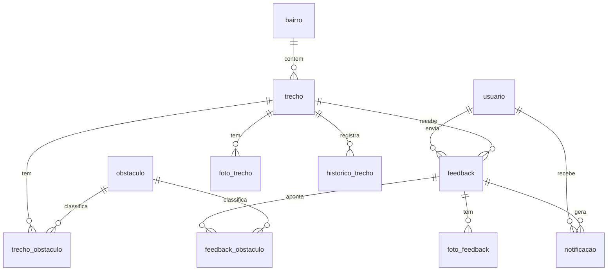

# Spec 0003: Modelo de dados de trechos e feedbacks

- **Status:** Implementado
- **Requisitos:** RF-10, RF-21, RF-29 e RNF-05 do [PRD 0001](../prd/0001-caminhabilidade-urbana.md); base para RF-09 a RF-34
- **Decisões:** [ADR 0004](../adr/0004-postgresql-como-banco-de-dados.md), [ADR 0006](../adr/0006-mapa-com-leaflet-e-openstreetmap.md), [ADR 0007](../adr/0007-regras-de-integridade-no-banco.md), [ADR 0008](../adr/0008-do-nothing-no-lugar-de-protect.md)
- **Depende de:** [Spec 0001](0001-fundacao.md)

Esta spec cria apenas a camada de dados: models, constraints, índices, dados de referência, trigger e view. Services, telas e regras de uso vêm nas specs seguintes. Leia antes a [skill postgresql](../../.agents/skills/postgresql/SKILL.md).

## Diagrama



## Escolhas compartilhadas (`trechos/models/escolhas.py`)

```python
class Classificacao(models.TextChoices):
    ACESSIVEL = "ACESSIVEL", "Acessível"
    PARCIAL = "PARCIAL", "Parcialmente acessível"
    INACESSIVEL = "INACESSIVEL", "Inacessível"
    SEM_AVALIACAO = "SEM_AVALIACAO", "Sem avaliação"

class Lado(models.TextChoices):
    PAR = "PAR", "Lado par"
    IMPAR = "IMPAR", "Lado ímpar"
    UNICO = "UNICO", "Lado único"
```

Limites de Maceió, usados nas constraints de coordenadas: latitude entre -9.80 e -9.30; longitude entre -35.90 e -35.50.

## App `trechos`

### `Bairro` — tabela `bairro`

| Campo | Tipo | Regras |
|---|---|---|
| `nome` | `CharField(max_length=80, unique=True)` | |

### `Obstaculo` — tabela `obstaculo`

| Campo | Tipo | Regras |
|---|---|---|
| `codigo` | `SlugField(max_length=40, unique=True)` | Ex.: `degrau` |
| `nome` | `CharField(max_length=60, unique=True)` | Ex.: "Degrau ou desnível" |

### `Trecho(ModeloComDatas)` — tabela `trecho`

| Campo | Tipo | Regras |
|---|---|---|
| `logradouro` | `CharField(max_length=150)` | Obrigatório |
| `bairro` | `ForeignKey(Bairro, on_delete=DO_NOTHING, related_name="trechos")` | Obrigatório. `DO_NOTHING` deixa o banco com `NO ACTION`, que impede excluir um bairro em uso ([ADR 0008](../adr/0008-do-nothing-no-lugar-de-protect.md)) |
| `referencia_inicio` | `CharField(max_length=150)` | Ex.: "Esquina com a Rua A" |
| `referencia_fim` | `CharField(max_length=150)` | |
| `lado` | `CharField(max_length=5)` com `Lado` | |
| `lat_inicio`, `lng_inicio`, `lat_fim`, `lng_fim` | `DecimalField(max_digits=9, decimal_places=6)` | |
| `classificacao` | `CharField(max_length=15)` com `Classificacao` | Padrão `SEM_AVALIACAO` |
| `obstaculos` | `ManyToManyField(Obstaculo, through="TrechoObstaculo", blank=True)` | |
| `ativo` | `BooleanField(default=True)` | |
| `observacoes` | `TextField(blank=True, default="")` | Até 500 caracteres |
| `atualizado_por` | `ForeignKey(settings.AUTH_USER_MODEL, on_delete=models.DB_SET_NULL, null=True, blank=True, related_name="+")` | Lido pela trigger |

Constraints:

| Nome | Integridade | Regra |
|---|---|---|
| `ck_trecho_classificacao_valida` | Domínio | `classificacao` dentro das opções |
| `ck_trecho_lado_valido` | Domínio | `lado` dentro das opções |
| `ck_trecho_coordenadas_em_maceio` | Definida pelo usuário | As quatro coordenadas dentro dos limites de Maceió |
| `ck_trecho_pontos_distintos` | Definida pelo usuário | Início diferente do fim (não podem ser iguais latitude **e** longitude) |
| `ck_trecho_observacoes_tamanho` | Domínio | `observacoes` com até 500 caracteres |
| `uq_trecho_logradouro_referencias_lado` | Entidade | Únicos juntos: `logradouro`, `referencia_inicio`, `referencia_fim`, `lado` |

Índice: `idx_trecho_bairro_classif` em (`bairro`, `classificacao`), para os filtros do mapa e da gestão. O nome é abreviado porque o Django limita nomes de índice a 30 caracteres (check `models.E034`).

`__str__`: `"{logradouro} ({referencia_inicio} → {referencia_fim})"`.

### `TrechoObstaculo` — tabela `trecho_obstaculo`

`trecho` (`DB_CASCADE`) e `obstaculo` (`DO_NOTHING`), com `uq_trecho_obstaculo` em (`trecho`, `obstaculo`).

### `FotoTrecho` — tabela `foto_trecho`

`trecho` (`DB_CASCADE`, `related_name="fotos"`), `imagem` (`ImageField(upload_to="trechos/%Y/%m/")`), `descricao` (`CharField(max_length=150, blank=True)`, usado como texto alternativo) e `criado_em`. Fotos de trecho cadastradas pela equipe são públicas.

### `HistoricoTrecho` — tabela `historico_trecho`

| Campo | Tipo | Regras |
|---|---|---|
| `trecho` | `ForeignKey(Trecho, on_delete=models.DB_CASCADE, related_name="historico")` | |
| `classificacao_anterior` | `CharField(max_length=15, null=True)` | Nula no cadastro do trecho |
| `classificacao_nova` | `CharField(max_length=15)` | |
| `alterado_por` | `ForeignKey(settings.AUTH_USER_MODEL, on_delete=models.DB_SET_NULL, null=True, related_name="+")` | |
| `alterado_em` | `DateTimeField(db_default=Now())` | |

Gravada **somente** pela trigger. No Admin, somente leitura.

### `TrechoMapa` — view `vw_trechos_mapa`

Model somente leitura (`managed = False`, `db_table = "vw_trechos_mapa"`), com os campos da view abaixo e `id` como chave primária. Não tem `save` nem `delete` utilizáveis.

## App `feedbacks`

### Escolhas

```python
class TipoFeedback(models.TextChoices):
    NOVO_PROBLEMA = "NOVO_PROBLEMA", "Novo problema"
    PROBLEMA_RESOLVIDO = "PROBLEMA_RESOLVIDO", "Problema resolvido"
    CLASSIFICACAO_INCORRETA = "CLASSIFICACAO_INCORRETA", "Classificação incorreta"

class StatusFeedback(models.TextChoices):
    EM_ANALISE = "EM_ANALISE", "Em análise"
    ACEITO = "ACEITO", "Aceito"
    REJEITADO = "REJEITADO", "Rejeitado"

class MotivoRejeicao(models.TextChoices):
    FOTO_NAO_CORRESPONDE = "FOTO_NAO_CORRESPONDE", "Foto não corresponde ao local"
    INFORMACAO_INCORRETA = "INFORMACAO_INCORRETA", "Informação incorreta"
    CONTEUDO_IMPROPRIO = "CONTEUDO_IMPROPRIO", "Conteúdo impróprio"
    DUPLICADO = "DUPLICADO", "Duplicado"
    OUTRO = "OUTRO", "Outro"
```

### `Feedback(ModeloComDatas)` — tabela `feedback`

| Campo | Tipo | Regras |
|---|---|---|
| `usuario` | `ForeignKey(settings.AUTH_USER_MODEL, on_delete=models.DB_SET_NULL, null=True, related_name="feedbacks")` | Nulo apenas se a conta for removida, mantendo o relato anônimo |
| `trecho` | `ForeignKey(Trecho, on_delete=DO_NOTHING, related_name="feedbacks")` | `NO ACTION` no banco: trecho com feedback não pode ser excluído |
| `tipo` | `CharField(max_length=25)` com `TipoFeedback` | |
| `classificacao_sugerida` | `CharField(max_length=15, null=True, blank=True)` com `Classificacao` | |
| `descricao` | `TextField` | 10 a 500 caracteres |
| `obstaculos` | `ManyToManyField(Obstaculo, through="FeedbackObstaculo", blank=True)` | |
| `enviado_a_distancia` | `BooleanField(default=False)` | |
| `status` | `CharField(max_length=12)` com `StatusFeedback` | Padrão `EM_ANALISE` |
| `motivo_rejeicao` | `CharField(max_length=25, null=True, blank=True)` com `MotivoRejeicao` | |
| `motivo_rejeicao_texto` | `CharField(max_length=300, blank=True, default="")` | |
| `analisado_por` | `ForeignKey(settings.AUTH_USER_MODEL, on_delete=models.DB_SET_NULL, null=True, blank=True, related_name="+")` | |
| `analisado_em` | `DateTimeField(null=True, blank=True)` | |

Constraints:

| Nome | Integridade | Regra |
|---|---|---|
| `ck_feedback_tipo_valido` | Domínio | `tipo` dentro das opções |
| `ck_feedback_status_valido` | Domínio | `status` dentro das opções |
| `ck_feedback_classificacao_sugerida_valida` | Domínio | Nula ou uma de `ACESSIVEL`, `PARCIAL`, `INACESSIVEL` |
| `ck_feedback_motivo_rejeicao_valido` | Domínio | Nulo ou dentro das opções de `MotivoRejeicao` (exigido pela skill postgresql para todo campo com `choices`) |
| `ck_feedback_descricao_tamanho` | Domínio | Descrição com 10 a 500 caracteres |
| `ck_feedback_rejeicao_exige_motivo` | Definida pelo usuário | `status = REJEITADO` se e somente se `motivo_rejeicao` não for nulo |
| `ck_feedback_motivo_outro_exige_texto` | Definida pelo usuário | `motivo_rejeicao = OUTRO` exige `motivo_rejeicao_texto` não vazio |
| `ck_feedback_analise_exige_data` | Definida pelo usuário | `status = EM_ANALISE` se e somente se `analisado_em` for nulo |
| `uq_feedback_um_em_analise_por_trecho` | Definida pelo usuário | `UniqueConstraint(fields=["usuario", "trecho"], condition=Q(status="EM_ANALISE"))`: 1 feedback em análise por usuário e trecho (RF-21) |

Índice: `idx_feedback_status_criado` em (`status`, `criado_em`), usado pela fila de análise.

### `FeedbackObstaculo` — tabela `feedback_obstaculo`

`feedback` (`DB_CASCADE`) e `obstaculo` (`DO_NOTHING`), com `uq_feedback_obstaculo`.

### `FotoFeedback` — tabela `foto_feedback`

`feedback` (`DB_CASCADE`, `related_name="fotos"`), `imagem` (`ImageField(upload_to="feedbacks/%Y/%m/")`), `aprovada` (`BooleanField(default=False)`) e `criado_em`.

### `Notificacao` — tabela `notificacao`

| Campo | Tipo | Regras |
|---|---|---|
| `usuario` | `ForeignKey(settings.AUTH_USER_MODEL, on_delete=models.DB_CASCADE, related_name="notificacoes")` | |
| `feedback` | `ForeignKey(Feedback, on_delete=models.DB_CASCADE, related_name="notificacoes")` | |
| `mensagem` | `CharField(max_length=200)` | |
| `lida` | `BooleanField(default=False)` | |
| `criado_em` | `DateTimeField(auto_now_add=True)` | |

## Dados de referência (migração de dados em `trechos`)

`RunPython` com função de reversão, para que os dados existam também no banco de testes:

- **Obstáculos** (código → nome): `degrau` Degrau ou desnível; `buraco` Buraco; `poste-placa` Poste ou placa; `lixeira` Lixeira; `mesa-cadeira` Mesa ou cadeira; `veiculo` Veículo estacionado; `rampa-ausente` Rampa ausente; `inclinacao` Calçada inclinada; `piso-irregular` Piso irregular; `obra` Obra; `sem-calcada` Ausência de calçada; `outro` Outro.
- **Bairros de Maceió:** Antares, Barro Duro, Bebedouro, Benedito Bentes, Bom Parto, Canaã, Centro, Chã da Jaqueira, Chã de Bebedouro, Cidade Universitária, Clima Bom, Cruz das Almas, Farol, Feitosa, Fernão Velho, Garça Torta, Gruta de Lourdes, Guaxuma, Ipioca, Jacarecica, Jacintinho, Jaraguá, Jardim Petrópolis, Jatiúca, Levada, Mangabeiras, Mutange, Ouro Preto, Pajuçara, Pescaria, Petrópolis, Pinheiro, Pitanguinha, Poço, Ponta da Terra, Ponta Grossa, Ponta Verde, Pontal da Barra, Prado, Riacho Doce, Santa Amélia, Santa Lúcia, Santo Amaro, Santos Dumont, São Jorge, Serraria, Tabuleiro do Martins, Trapiche da Barra, Vergel do Lago.

## Trigger (migração `RunSQL` em `trechos`, depois da criação das tabelas)

```sql
CREATE OR REPLACE FUNCTION fn_registrar_historico_trecho()
RETURNS trigger AS $$
BEGIN
    -- Em uma alteração, só registra se a classificação realmente mudou.
    IF TG_OP = 'UPDATE' AND NEW.classificacao IS NOT DISTINCT FROM OLD.classificacao THEN
        RETURN NEW;
    END IF;

    INSERT INTO historico_trecho (trecho_id, classificacao_anterior, classificacao_nova, alterado_por_id, alterado_em)
    VALUES (
        NEW.id,
        CASE WHEN TG_OP = 'UPDATE' THEN OLD.classificacao ELSE NULL END,
        NEW.classificacao,
        NEW.atualizado_por_id,
        now()
    );
    RETURN NEW;
END;
$$ LANGUAGE plpgsql;

CREATE TRIGGER trg_trecho_historico
AFTER INSERT OR UPDATE OF classificacao ON trecho
FOR EACH ROW
EXECUTE FUNCTION fn_registrar_historico_trecho();
```

Reversão: `DROP TRIGGER IF EXISTS trg_trecho_historico ON trecho; DROP FUNCTION IF EXISTS fn_registrar_historico_trecho();`

## View (migração `RunSQL` em `feedbacks`, pois depende da tabela `feedback`)

```sql
CREATE OR REPLACE VIEW vw_trechos_mapa AS
SELECT
    t.id,
    t.logradouro,
    b.id   AS bairro_id,
    b.nome AS bairro,
    t.referencia_inicio,
    t.referencia_fim,
    t.lado,
    t.lat_inicio, t.lng_inicio, t.lat_fim, t.lng_fim,
    t.classificacao,
    t.atualizado_em,
    (CURRENT_DATE - t.atualizado_em::date) AS dias_sem_atualizacao,
    COUNT(f.id) FILTER (WHERE f.status = 'EM_ANALISE') AS feedbacks_em_analise
FROM trecho t
JOIN bairro b ON b.id = t.bairro_id
LEFT JOIN feedback f ON f.trecho_id = t.id
WHERE t.ativo
GROUP BY t.id, b.id;
```

Reversão: `DROP VIEW IF EXISTS vw_trechos_mapa;`

O model `TrechoMapa` fica em `trechos/models/`, mas sua migração (`CreateModel` com `managed = False`) não cria nada no banco.

## Admin

Todos os models registrados somente leitura (`has_add_permission`, `has_change_permission` e `has_delete_permission` retornam `False`), exceto `Bairro` e `Obstaculo`, que podem ser criados e editados, mas não excluídos: com `DO_NOTHING`, excluir um registro em uso só falharia no banco.

## Testes

- [x] A migração de dados cria os 12 obstáculos e os bairros.
- [x] O banco rejeita (`IntegrityError`): classificação inválida, coordenada fora de Maceió, início igual ao fim e trecho duplicado.
- [x] O banco rejeita: feedback rejeitado sem motivo, motivo `OUTRO` sem texto, feedback aceito sem `analisado_em`, descrição com menos de 10 caracteres.
- [x] O banco rejeita um segundo feedback `EM_ANALISE` do mesmo usuário no mesmo trecho, mas aceita depois que o primeiro é aceito ou rejeitado.
- [x] A trigger grava uma linha no histórico ao criar o trecho (com anterior nulo) e outra ao mudar a classificação, com `alterado_por`.
- [x] A trigger **não** grava histórico quando outro campo muda e a classificação continua a mesma.
- [x] `TrechoMapa` lista apenas trechos ativos e conta só os feedbacks em análise.
- [x] Excluir um trecho no banco exclui suas fotos, obstáculos e histórico (`ON DELETE CASCADE`), mas é bloqueado se ele tiver feedbacks.
